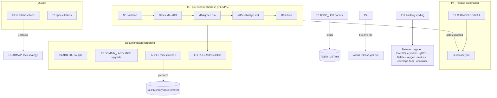

# Pareto Plan — Release Hardening & go-etag Adoption (go-idempotency)

**Date:** 2026-10-19 12:17
**Input:** `docs/status/2026-10-19_06-14_go-etag-cross-repo-learning-review.md` (session findings + 22 ranked tasks), `TODO_LIST.md`, `ROADMAP.md`, go-etag validated release protocol.
**Method:** pareto-planning skill — Step 0 verification first, then 1%/4%/20% tiers, two-level breakdown (30–100 min → ≤12 min).

---

## Step 0 — Verification & Errata (read before executing anything)

Every task from the status report was re-verified against source. Three claims from the 06:14 report are corrected here:

| # | Erratum | Evidence (this session) |
|---|---------|------------------------|
| E1 | Status task 15 ("add real-wire integration test for middleware") is **already done** — `middleware/http_test.go` uses `httptest.NewServer` + real client round-trips throughout | File read 2026-10-19; `TestHTTP_FirstRequestProcesses` et al. |
| E2 | "middleware probably depends on root" → **confirmed fact**: `middleware.go` imports the root package, matches `idempotency.ErrDuplicate`/`ErrInvalidTTL` (middleware.go:43–45) | File read |
| E3 | Fleet survey was a 4-consumer sample → **now full population**: 10/10 consumers swept. Root-only: DiscordSync, Zlota44, cqrs-htmx, file-and-image-renamer. Root+contract: KeyHolderAI, bank-sync. Indirect-only: Cyberdom, accountability-system, go-localsync, crm. **Zero consumers import `middleware/`** | grep sweep across `~/projects/*/​**.go` |

**New finding (P2, live bug):** tag `v0.3.1` exists (`git tag`) but `CHANGELOG.md` contains **no `[0.3.1]` section** — grep for "0.3.1" in CHANGELOG returns nothing. The post-release doc-sync work sits under `[Unreleased]` instead of a released section. RELEASING.md steps 5–6 were skipped for v0.3.1. A one-command release gate (P1) fails loudly on exactly this class.

**Also verified:** RELEASING.md is solid on the basics (gofmt/vet/race/lint gates, tidy-diff-on-copy, godoc read-through, annotated tag, proxy listing, `gh release create`) but lacks: `go mod verify`, proxy `.info`-hash == commit, clean-room `go get`, erraudit, stale-refs in the gate list, an anchored go-directive floor check, and tag↔CHANGELOG parity. CI pins the toolchain via `go-version-file: go.mod` (no numeric pin to drift — the residual risk is the go directive itself being relaxed; go-etag's `969d077` daemon incident is the precedent). ADR index ends at 004 → next is **ADR-005**. TODO_LIST has 4 open items (2 demand-gated, 1 owner-blocked, 1 owner-preference); ROADMAP holds the raw ideas. Today's 05:59 BuildFlow session (securitymd + AGENTS freshness) has zero overlap with this plan.

---

## Step 1 — Pareto Breakdown

### The 1% that delivers 51%

**P1 — `scripts/pre-release-check.sh`: one failure-loud command encoding the entire release gate.**
It is the keystone because (a) every future release inherits every gate below in one invocation, (b) it would have *caught the v0.3.1 changelog gap that already happened*, (c) it retro-justifies itself: the one release where the checklist was run manually step-by-step (v0.3.1) is the one where a step was skipped. Encodes: gofmt, go vet, build, `go test -race`, golangci-lint (config verify + run), tidy-diff-on-copy, `go mod verify`, erraudit (`--enforce-go-error-family`), check-stale-refs, anchored `go 1.27` directive check, tag↔CHANGELOG parity, clean-tree check.

### The 4% that deliver 64% (P1 +)

- **P2 — CHANGELOG `[0.3.1]` retroactive section** (from `git log v0.3.0..v0.3.1`) + compare links. Fixes a live docs bug; the lychee job's compare links currently misdescribe reality.
- **P3 — ADR-005: no module split.** Records this session's verdict with fleet evidence (E3) and the two future triggers (contract gains a heavy test dep; a consumer demands a middleware-only import path). Without it, the verdict lives only in a timestamped report.
- **P4 — `release.yml`:** tag-triggered workflow extracting the CHANGELOG section and creating the GitHub Release as Latest, failing loudly when the section is absent — the structural prevention for P2's bug class.

### The 20% that deliver 80% (P1–P4 +)

- **P5 — DOMAIN_LANGUAGE.md upgrades** (Where-citation column, Bounded contexts, Deprecated terms).
- **P6 — TODO_LIST.md harvest** from this plan (prevents entombment; adds the actionable items with impact/effort, prunes E1).
- **P7 — MemoryStore v1.0 removal mini-staircase** pre-recorded (modeled on go-etag's validated v1.0.0 deletion plan), incl. the fleet `rg MemoryStore` audit.
- **P8 — Benchmark baseline convention** (`reports/bench/<date>_<name>.txt`, `-count=6 -benchmem`) + capture the initial baselines. Unblocks the ROADMAP lock-strategy work, which is meaningless without baselines.
- **P9 — Spec-citation pass** over the 13 contract invariants (each cites its authority: TOCTOU, claim semantics, ADR).

### The other 80% → 100% (deferred / demand-gated / owner-gated — the tail)

| Item | Gate | Owner |
|------|------|-------|
| Coverage floor (~90%) in CI | `CODECOV_TOKEN` secret set | Owner |
| Announce v0.3.x | channel/timing call | Owner |
| `EventIdempotency` / `QueryIdempotency` | first consumer need | YAGNI (ADR-002) |
| gRPC adapter (+ ADR-002 supplement first) | first consumer need | YAGNI |
| `Delete(ctx, key)` on Store | demonstrated poisoned-claim need | ADR-004 deferral |
| Key-generation utilities | design session (ROADMAP raw idea) | — |
| Metrics hooks | design session (ROADMAP raw idea) | — |
| Lock strategy optimization | **blocked on P8 baselines** | — |
| v1.0 execution (MemoryStore removal) | mini-staircase (P7) + multiple wild backends | ROADMAP |
| Watch `release.yml` first live fire | next root tag after P4 | — |

---

## Step 2 — Comprehensive Plan (30–100 min per task, sorted by importance/impact/effort/customer-value)

| # | Task | Delivers | Impact | Effort (min) | Category | Depends |
|---|------|----------|--------|--------------|----------|----------|
| T1 | Write `scripts/pre-release-check.sh` (all gates from P1), smoke-test green + red on the live tree, document in AGENTS.md Commands | P1 | Critical | 90 | Quality | — |
| T2 | Add retroactive `[0.3.1]` CHANGELOG section + compare links; run stale-refs | P2 | High | 30 | Documentation | — |
| T3 | Write ADR-005 (no module split; evidence + triggers); link from ADR index + AGENTS.md; annotate 06:14 report | P3 | High | 40 | Documentation | — |
| T4 | Add `release.yml` (tag-triggered, CHANGELOG-section extractor, Latest Release, fail-loud); actionlint + local extractor dry-run; update RELEASING.md step 10 | P4 | High | 75 | Feature | T2 (extractor needs stable sections) |
| T5 | Upgrade DOMAIN_LANGUAGE.md: Where column, Bounded contexts, Deprecated terms | P5 | Medium | 55 | Documentation | — |
| T6 | Harvest this plan → TODO_LIST.md (house style, impact/effort); prune E1 | P6 | Medium | 30 | Documentation | Plan approved |
| T7 | Pre-record MemoryStore v1.0 mini-staircase + fleet `MemoryStore` usage audit; link from ROADMAP v1.0 bullet | P7 | High | 60 | Documentation | — |
| T8 | Benchmark baseline convention: capture initial `-count=6 -benchmem` baselines to `reports/bench/`; document in AGENTS.md | P8 | Medium | 50 | Quality | — |
| T9 | Spec-citation pass: map 13 invariants → authorities; edit `contract/contract.go` names/comments; verify negative-test README rows 1:1 | P9 | Medium | 60 | Quality | — |
| T10 | Draft coverage-floor CI step (Codecov threshold) behind the token flag as a ready-to-flip diff | Tail | Medium | 30 | Infrastructure | Owner token |
| T11 | RELEASING.md deltas: proxy `.info`-hash check, clean-room `go get`, `go mod verify`, point gates at T1's script | P1/P4 | Medium | 30 | Documentation | T1 |
| T12 | Backlog tending: annotate ROADMAP demand-gated items with 2026-10-19 fleet evidence; re-confirm YAGNI gates | Tail | Low | 30 | Cleanup | — |

**Total: ~9.5 h.** 12 tasks covers ALL open TODOs (actionable now + deferred registers below).

### Deferred register (tracked, not scheduled)

- **Owner-gated:** coverage floor activation (T10 prepares it), v0.3.x announcement.
- **Demand-gated (YAGNI):** EventIdempotency/QueryIdempotency, gRPC adapter + ADR-002 supplement, `Delete` on Store.
- **Design-gated (ROADMAP raw):** key-generation utilities, metrics hooks.
- **Blocked:** lock strategy optimization (needs T8); v1.0 execution (needs T7 + wild backends).

---

## Step 3 — Fine Breakdown (≤12 min per task, sorted by execution order within dependency groups)

| # | Micro-task | Task | Est (min) |
|---|-----------|------|-----------|
| M1 | Script skeleton: `set -euo pipefail`, cache-env prefixes, step counter, summary trap | T1 | 12 |
| M2 | Gate: `gofmt -l .` empty | T1 | 6 |
| M3 | Gate: `go vet ./...` | T1 | 5 |
| M4 | Gate: `go build ./...` | T1 | 5 |
| M5 | Gate: `go test ./... -race -count=1` | T1 | 12 |
| M6 | Gate: `golangci-lint config verify` + `run ./...` | T1 | 12 |
| M7 | Gate: tidy-diff-on-copy (RELEASING.md §3 recipe as function) | T1 | 12 |
| M8 | Gate: `go mod verify` | T1 | 4 |
| M9 | Gate: erraudit `--enforce-go-error-family` (expect 0) | T1 | 6 |
| M10 | Gate: `scripts/check-stale-refs.sh` | T1 | 4 |
| M11 | Gate: anchored go-directive check (`go 1.27` exact) | T1 | 8 |
| M12 | Gate: tag↔CHANGELOG parity (latest tag has section; `[Unreleased]` link valid) | T1 | 12 |
| M13 | Gate: clean-tree check (`git status --porcelain` empty, warn-only) | T1 | 6 |
| M14 | End-to-end smoke on clean tree → exit 0 | T1 | 12 |
| M15 | Sabotage test (break one gate deliberately, verify loud failure, revert) | T1 | 12 |
| M16 | Document one-liner in AGENTS.md Commands | T1 | 6 |
| M17 | Extract `git log v0.3.0..v0.3.1` + diff stat | T2 | 5 |
| M18 | Draft `[0.3.1]` section (post-release doc sync: README link, doc.go paragraph, stale-refs patterns) | T2 | 12 |
| M19 | Add compare links; fix `[Unreleased]` target | T2 | 8 |
| M20 | Run stale-refs + render check | T2 | 6 |
| M21 | Draft ADR-005: context (go-etag anatomy), evidence (E3 matrix, contract dep-free), decision, triggers | T3 | 12 |
| M22 | Finish ADR-005 body + status header | T3 | 12 |
| M23 | Link from `docs/adr/README.md` + AGENTS.md Architecture | T3 | 8 |
| M24 | Annotate 06:14 status report with ADR-005 pointer (append, don't rewrite) | T3 | 6 |
| M25 | `release.yml` skeleton: `on.push.tags: v*`, least permissions | T4 | 10 |
| M26 | Extractor step (heading-prefix match; fail if section absent) | T4 | 12 |
| M27 | Release step (gh CLI, notes-file from extractor, `--latest`, idempotent) | T4 | 10 |
| M28 | actionlint + extractor dry-run against current CHANGELOG | T4 | 12 |
| M29 | Update RELEASING.md step 10 (auto path + manual fallback) | T4 | 8 |
| M30 | DOMAIN_LANGUAGE: Where column — Core Concepts table | T5 | 12 |
| M31 | DOMAIN_LANGUAGE: Where column — Operations + Errors + Design tables | T5 | 12 |
| M32 | DOMAIN_LANGUAGE: Bounded contexts section (Store / middleware / contract vocab) | T5 | 10 |
| M33 | DOMAIN_LANGUAGE: Deprecated terms section (MemoryStore) | T5 | 8 |
| M34 | Harvest actionable tasks → TODO_LIST.md (house style) | T6 | 12 |
| M35 | Prune/annotate E1 (real-wire test already done) in TODO_LIST | T6 | 5 |
| M36 | Fleet audit: `rg -l "MemoryStore"` across consumer repos; usage matrix | T7 | 12 |
| M37 | Draft mini-staircase: preconditions, steps, major-bump plan | T7 | 12 |
| M38 | Finish + store doc; link from ROADMAP v1.0 bullet | T7 | 10 |
| M39 | Capture timing baselines (CheckAndRecord/Seen/Record, serial+contended+parallel) | T8 | 12 |
| M40 | Capture memory baselines (bytes/key, %-reclaimed) | T8 | 12 |
| M41 | Document baseline convention in AGENTS.md Testing Conventions | T8 | 8 |
| M42 | Map 13 invariants → authority (TOCTOU/claim/TTL/family/ADR) | T9 | 12 |
| M43 | Apply citations in contract.go; run contract suite | T9 | 12 |
| M44 | Verify negative-test README rows 1:1 with invariants | T9 | 6 |
| M45 | Draft coverage-threshold codecov step as ready diff (in TODO_LIST note) | T10 | 12 |
| M46 | RELEASING.md: add proxy `.info`-hash + clean-room `go get` steps | T11 | 10 |
| M47 | RELEASING.md: point verification gates at pre-release-check.sh | T11 | 6 |
| M48 | Annotate ROADMAP demand-gated items with fleet evidence; sweep TODO_LIST | T12 | 12 |

**48 micro-tasks, ~7.3 h total.** Every open item is scheduled or explicitly registered as deferred.

---

## Step 4 — Execution Graph

**Suggested execution order:** T1 → T2 → T3 → T4 → T11 → T6 (harvest while fresh) → T7 → T5 → T8 → T9 → T10 → T12. T1 first because T4/T11 build on its gates; T6 immediately after the top four so the living backlog absorbs the plan.

---

## Anti-Verschlimmbesserung Contract

- No Go API changes; no dependency changes; no CI job removals. T4 only *adds* a workflow; manual `gh release create` stays as documented fallback.
- The `[0.3.1]` section is reconstructed strictly from `git log v0.3.0..v0.3.1` — no invented entries.
- DOMAIN_LANGUAGE edits add columns/sections; existing definitions are not rewritten.
- The 06:14 status report is annotated (appendix only), never rewritten.
- Every gate in T1 that can fail on the *current* tree is smoke-tested both green and red before commit.

## Post-Plan Obligations

- **HARVEST (docs-health):** after approval, T6 folds the actionable items into `TODO_LIST.md`; the deferred register maps to ROADMAP annotations (T12). This plan is a snapshot — the living docs own the items afterward.
- **ANNOTATE, never rewrite:** when this plan goes stale, correct it via inline annotation or appendix per docs-health.
