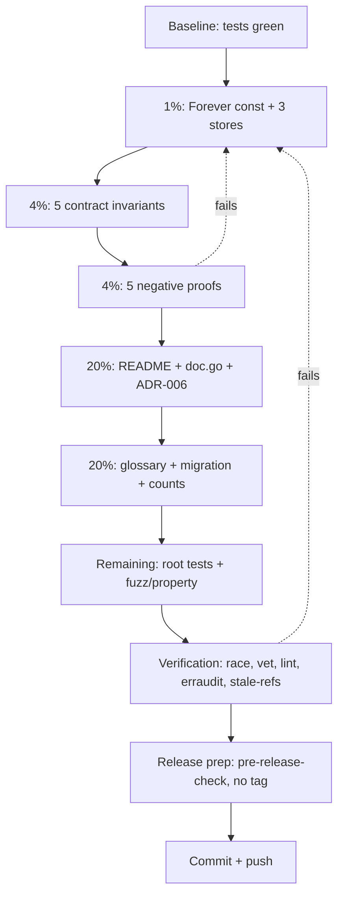

# SUPERB PLAN: `idempotency.Forever` (permanent claims)

**Date:** 2026-11-17 12:33 CET
**Repo:** `github.com/larsartmann/go-idempotency`
**Status:** owner green-lit 2026-11-17. Execution starts after this file is written.
**Scope:** the `Forever` semantic in this module: constant, MemoryStore,
contract suite, negative proofs, docs, tests, release prep. Downstream
propagation (go-cqrs-lite `metaengine`/`claimkit`, CV, DiscordSync) is listed
as follow-up, not executed here.

## 1. Context: why this plan exists

A cross-repo plan from 2026-09-16
(`cv/docs/planning/2026-09-16_18-52_forever-ttl-ecosystem-execution-plan.md`,
M1-M18) recorded the gap and waited for an owner green light. The evidence:

- CV hand-rolled a forever store after a real corruption bug: a redelivered
  event folded twice when the TTL expired
  (`CV/career-pipeline/eventstore/idempotency.go`).
- go-taskqueue's permanent `DedupKey` and invoices' "an invoice may only be
  submitted once" guard need the same never-expire semantics.
- The 25-report consumer corpus (synthesis:
  `docs/reviews/2026-11-17_consumer-audit-synthesis.html`) shows permanent
  claims are the most common reason a consumer stays off this library.

Today `Store` rejects `ttl <= 0` and has no way to express "never expires".
`Forever` closes that gap without turning a forgotten TTL into a permanent
claim.

## 2. Decisions locked by this plan

| Decision | Value | Why |
| --- | --- | --- |
| Sentinel value | `const Forever time.Duration = 1<<63 - 1` (`math.MaxInt64`) | Matches the ecosystem plan. A positive Duration, so `ttl <= 0` stays the only rejection. |
| `ttl == 0` | Still `ErrInvalidTTL` | A forgotten TTL must stay loud. `Forever` is the explicit opt-in. |
| In-process representation | zero `time.Time` (`time.Time{}`) means never expires | No `Add` arithmetic, no overflow. `Seen`/`Record`/`CheckAndRecord`/sweep special-case `IsZero()`. |
| Backend representation | sentinel stored directly: Redis no `EX`, SQL `NULL` or max-sentinel, DynamoDB no TTL attribute | `now.Add(Forever)` is representable in `time.Time` (~2318) but `UnixNano` overflows in 2262. Never compute. |
| Live-key rule | `Record(Forever)` on a live short-TTL key is a no-op; `Record(short)` on a live Forever key is a no-op | The existing no-TTL-extension rule applies in both directions. No silent upgrades or downgrades. |
| Sweep | Never deletes a zero-time entry | Otherwise the sweeper would delete every permanent claim on its first tick. |
| Scope | Consumer/event dedupe and other permanent invariants | Request-facing `Idempotency-Key` claims should stay TTL-windowed: a permanent claim turns a crashed request into a permanent lockout. |
| Errors | No new sentinels; `ErrInvalidTTL` doc gains the `Forever` carve-out | The API surface stays three methods and two sentinels. |
| Version | Additive feature, next minor (`v0.4.0`); this plan does not tag | Tagging is a release action; commit and push are requested, tag is not. |

## 3. Pareto breakdown

### The 1% that delivers 51%

The semantic itself, in one library:

1. `Forever` constant with scope docs.
2. `isLive` / `expiryFor` helpers and the three-store update (MemoryStore,
   `internal/teststore`, example `demoStore`) so zero time means permanent.
3. One contract invariant proving a permanent claim survives a read after the
   sleep window.

Without this, nothing else is testable.

### The 4% that delivers 64%

The guarantee machinery:

1. Five contract invariants:
   `Seen/ForeverSurvives`, `Record/ForeverNeverExpires`,
   `Record/ForeverNoopOnExistingKey`, `Record/ForeverNotDowngraded`,
   `CheckAndRecord/Forever`.
2. Five deliberately broken stores, one per invariant, so the suite is proven
   to detect each violation and name it.
3. The invariant table and negative-count updates in README, CONTRIBUTING,
   FEATURES, AGENTS, SECURITY.

### The 20% that delivers 80%

Documentation and decision record:

1. ADR-006: the semantic, the scope split, the overflow rule, the backend
   encodings, the alternatives rejected.
2. `doc.go` Forever section plus backend-specific encodings (Redis, SQL,
   SQLite, DynamoDB).
3. README FAQ rewrite: request claims stay TTL-windowed, consumer/event dedupe
   may be permanent.
4. `docs/DOMAIN_LANGUAGE.md` terms and `docs/migrating-from-memorystore.md`
   guidance.
5. CHANGELOG `[Unreleased]` and ROADMAP version bullet.

### The remaining 80% to 100%

1. Root tests: unit, lifecycle sweep, property, fuzz, example contract.
2. Full verification: gofmt, vet, `go test ./... -race`, golangci-lint,
   erraudit, stale-refs.
3. Release prep: confirm the pre-release gate remains green without a tag.
4. Commit and push.
5. Downstream follow-up plan (not executed here): go-cqrs-lite
   `metaengine.DedupStore` and `claimkit` must learn the sentinel; CV and
   DiscordSync converge.

## 4. Comprehensive plan (30-100 minute tasks)

Sorted by tier, then impact. Effort is an estimate; impact is 1-10;
customer value is H/M/L.

| ID | Task | Tier | Impact | Effort | Value | Depends on |
| --- | --- | --- | --- | --- | --- | --- |
| M1 | ADR-006: lock the Forever semantic, scope split, encodings, rejected alternatives | 20% | 9 | 60m | H | - |
| M2 | Core API: `Forever` constant, `isLive`/`expiryFor`, Store docs | 1% | 10 | 30m | H | M1 |
| M3 | MemoryStore: Seen/Record/CheckAndRecord/sweep Forever semantics | 1% | 10 | 30m | H | M2 |
| M4 | `internal/teststore` and example `demoStore` parity | 1% | 9 | 30m | H | M2 |
| M5 | Five contract invariants | 4% | 10 | 60m | H | M3, M4 |
| M6 | Five negative stores and scenarios | 4% | 9 | 60m | H | M5 |
| M7 | Contract package docs + README invariant table rows | 4% | 7 | 45m | H | M5 |
| M8 | Root tests: unit, lifecycle sweep, property, fuzz | 80% | 8 | 60m | M | M3 |
| M9 | README: design bullet, FAQ rewrite, backend Forever mapping, counts | 20% | 9 | 75m | H | M5 |
| M10 | `doc.go`: Forever section, backend encodings, TOC | 20% | 9 | 90m | H | M2 |
| M11 | `DOMAIN_LANGUAGE.md` + `migrating-from-memorystore.md` | 20% | 6 | 45m | M | M10 |
| M12 | AGENTS/FEATURES/CONTRIBUTING/SECURITY counts and decisions | 20% | 7 | 45m | M | M5 |
| M13 | CHANGELOG `[Unreleased]` + ROADMAP v0.4.0 bullet | 20% | 6 | 30m | M | M9 |
| M14 | Example: permanent-claim demonstration and godoc example | 80% | 5 | 30m | M | M4 |
| M15 | Full verification: race, vet, lint, erraudit, stale-refs | 80% | 8 | 60m | H | all |
| M16 | Release prep: run `scripts/pre-release-check.sh`, record result, do not tag | 80% | 6 | 60m | M | M15 |
| M17 | Downstream follow-up notes for go-cqrs-lite/CV/DiscordSync | 80% | 5 | 30m | L | M10 |
| M18 | `git status`, detailed commit, push | 80% | 7 | 30m | H | M15-M17 |

## 5. Fine plan (max 12 minutes per task)

Every fine task maps to exactly one medium task. Tasks are in execution order;
impact and value are inherited from the parent unless noted.

| ID | Fine task | Parent | Min | Impact | Value |
| --- | --- | --- | --- | --- | --- |
| F01 | Read ADR-004/005 format and ADR index conventions | M1 | 6 | 6 | M |
| F02 | Draft ADR-006 status, context, and decision statement | M1 | 10 | 9 | H |
| F03 | Add the overflow/representation evidence table (2318 vs 2262) | M1 | 8 | 9 | H |
| F04 | Write consequences: scope split, backend duties, review triggers | M1 | 10 | 8 | H |
| F05 | Add ADR-006 to `docs/adr/README.md` | M1 | 4 | 6 | M |
| F06 | Add `Forever` constant and doc comment to `store.go` | M2 | 8 | 10 | H |
| F07 | Add `isLive` and `expiryFor` helpers | M2 | 6 | 10 | H |
| F08 | Update `ErrInvalidTTL` doc with the Forever carve-out | M2 | 5 | 7 | M |
| F09 | Update `Store.Record` and `CheckAndRecord` doc comments | M2 | 10 | 8 | H |
| F10 | `MemoryStore.Seen`: zero time is live | M3 | 4 | 10 | H |
| F11 | `MemoryStore.Record`: no upgrade, no downgrade, zero on Forever | M3 | 8 | 10 | H |
| F12 | `MemoryStore.CheckAndRecord`: zero on new/expired claim | M3 | 6 | 10 | H |
| F13 | `MemoryStore.sweep`: skip zero-time entries | M3 | 4 | 10 | H |
| F14 | Update MemoryStore struct/new docs | M3 | 4 | 6 | M |
| F15 | Add `isLive`/`expiryFor` to `internal/teststore` | M4 | 6 | 9 | H |
| F16 | Update teststore Seen/Record/CheckAndRecord/ForceRecord | M4 | 10 | 9 | H |
| F17 | Update example `demoStore` Seen/Record/CheckAndRecord | M4 | 10 | 9 | H |
| F18 | Run `go test ./...` (baseline after core change) | M4 | 6 | 8 | H |
| F19 | `Seen/ForeverSurvives` invariant | M5 | 8 | 10 | H |
| F20 | `Record/ForeverNeverExpires` invariant | M5 | 8 | 10 | H |
| F21 | `Record/ForeverNoopOnExistingKey` invariant (short then Forever) | M5 | 8 | 9 | H |
| F22 | `Record/ForeverNotDowngraded` invariant (Forever then short) | M5 | 8 | 9 | H |
| F23 | `CheckAndRecord/Forever` invariant (claim + duplicate) | M5 | 8 | 10 | H |
| F24 | Run `go test ./contract ./example` | M5 | 5 | 8 | H |
| F25 | Add `foreverExpires` broken store | M6 | 6 | 9 | H |
| F26 | Add `foreverRejected` broken store | M6 | 5 | 9 | H |
| F27 | Add `foreverDuplicateSwallowed` broken store | M6 | 10 | 9 | H |
| F28 | Add `foreverUpgrades` broken store | M6 | 8 | 9 | H |
| F29 | Reuse `ttlExtendingRecord` for `foreverDowngraded` | M6 | 5 | 9 | H |
| F30 | Guard `neverExpires` against Forever overflow | M6 | 5 | 8 | H |
| F31 | Register five negative scenarios | M6 | 8 | 9 | H |
| F32 | Run `go test ./contract` and confirm all five are caught | M6 | 8 | 10 | H |
| F33 | Update contract package doc ("Extending the suite") | M7 | 6 | 6 | M |
| F34 | Add five rows to the README invariant table | M7 | 10 | 8 | H |
| F35 | Update the invariant count 13 -> 18 everywhere in README | M7 | 8 | 8 | H |
| F36 | Update CONTRIBUTING's invariant summary | M7 | 8 | 6 | M |
| F37 | Add root unit tests for Forever in `store_test.go` | M8 | 10 | 8 | M |
| F38 | Add sweep-survives-Forever lifecycle test | M8 | 8 | 8 | H |
| F39 | Add `TestProperty_ForeverNeverExpires` | M8 | 10 | 8 | M |
| F40 | Add Forever assertions/seeds to fuzz targets | M8 | 10 | 7 | M |
| F41 | Run root tests with `-race` | M8 | 10 | 8 | H |
| F42 | README design-philosophy bullet: permanent claims | M9 | 6 | 9 | H |
| F43 | Rewrite the "supposed to be forever?" FAQ into the scope split | M9 | 12 | 9 | H |
| F44 | Add the backend Forever mapping table/paragraph | M9 | 12 | 9 | H |
| F45 | Update README feature bullets and negative count 19 -> 24 | M9 | 8 | 8 | H |
| F46 | Add the Forever entry to the doc.go contents list | M10 | 4 | 7 | M |
| F47 | Write the "Permanent claims (Forever)" section | M10 | 12 | 9 | H |
| F48 | Add Redis Forever encoding note | M10 | 8 | 8 | H |
| F49 | Add SQL/PostgreSQL Forever encoding note | M10 | 10 | 8 | H |
| F50 | Add SQLite Forever encoding note | M10 | 8 | 8 | H |
| F51 | Add DynamoDB no-TTL note | M10 | 5 | 6 | M |
| F52 | Update the SQL example comments for Forever | M10 | 10 | 7 | M |
| F53 | Add Forever terms to `DOMAIN_LANGUAGE.md` | M11 | 8 | 6 | M |
| F54 | Add a Forever section to the migration guide | M11 | 12 | 7 | M |
| F55 | Update AGENTS Store/contract counts and Forever decision | M12 | 10 | 7 | M |
| F56 | Update FEATURES row + negative count | M12 | 8 | 7 | M |
| F57 | Update SECURITY's invariant count | M12 | 3 | 4 | L |
| F58 | Add CHANGELOG `[Unreleased]` Added entry | M13 | 6 | 6 | M |
| F59 | Add a v0.4.0 bullet to ROADMAP versioning | M13 | 5 | 5 | M |
| F60 | Add a permanent-claim godoc example | M14 | 10 | 5 | M |
| F61 | Run `gofmt -l .` and fix | M15 | 4 | 8 | H |
| F62 | Run `go vet ./...` | M15 | 4 | 8 | H |
| F63 | Run `go test ./... -race` | M15 | 10 | 9 | H |
| F64 | Run `golangci-lint run ./...` | M15 | 10 | 8 | H |
| F65 | Run `erraudit . --enforce-go-error-family` | M15 | 8 | 7 | M |
| F66 | Run `./scripts/check-stale-refs.sh` | M15 | 4 | 7 | H |
| F67 | Run `scripts/pre-release-check.sh` (expect tag-parity skip) | M16 | 10 | 6 | M |
| F68 | Write downstream follow-up notes (go-cqrs-lite/CV/DiscordSync) | M17 | 10 | 5 | L |
| F69 | `git status`, detailed commit, push | M18 | 10 | 7 | H |

## 6. Execution graph

## 7. Verification gates

| Gate | Command | Pass condition |
| --- | --- | --- |
| Format | `gofmt -l .` | no output |
| Vet | `go vet ./...` | exit 0 |
| Tests | `go test ./... -race` | all packages pass |
| Contract detection | `go test ./contract -run TestNegative` | every scenario fails loudly and names its invariant |
| Lint | `golangci-lint run ./...` | no new findings |
| Error policy | `erraudit . --enforce-go-error-family` | 0 violations |
| Doc drift | `./scripts/check-stale-refs.sh` | `living docs clean` |
| Release gate | `./scripts/pre-release-check.sh` | all gates green (tag parity may report no tag) |

## 8. Risks and mitigations

| Risk | Mitigation |
| --- | --- |
| `now.Add(Forever)` overflow in a consumer adapter | ADR, `doc.go`, README and the constant's comment all say "store the sentinel directly; never compute". |
| Sweeper deletes permanent claims | `sweep` skips `exp.IsZero()`; a lifecycle test pins it. |
| `Record(Forever)` silently upgrades a live claim | `Record/ForeverNoopOnExistingKey` plus a broken store that upgrades. |
| `Record(short)` silently downgrades a permanent claim | `Record/ForeverNotDowngraded` plus a broken store that downgrades. |
| Consumers use `Forever` for HTTP request keys | README FAQ, `Forever` doc, ADR-006 scope split, DOMAIN_LANGUAGE. |
| Count references drift (13/19) | Update README, CONTRIBUTING, FEATURES, AGENTS, SECURITY in one pass; stale-refs has no count rule yet, so grep after. |
| Test suite flake from extra sleeps | Reuse `tm.waitAfter`; no new wall-clock beyond the existing scale. |

## 9. Definition of done

- `Forever` is exported and documented in the root package.
- MemoryStore, teststore and demoStore treat zero time as permanent, and the
  sweeper never removes it.
- Five new contract invariants pass against every correct store and fail
  against their matching broken store with the invariant name in the output.
- README, CONTRIBUTING, FEATURES, AGENTS, SECURITY, DOMAIN_LANGUAGE,
  migration guide, doc.go, CHANGELOG and ROADMAP agree on the semantic and the
  counts.
- ADR-006 is in the index.
- `go test ./... -race`, `go vet`, `golangci-lint`, `erraudit`,
  `check-stale-refs` and the pre-release gate are green.
- A detailed commit exists and `git push` succeeds.

## 10. Execution result (2026-11-17)

| Task | Status | Evidence |
| --- | --- | --- |
| M1 ADR-006 | Done | `docs/adr/006-forever-permanent-claims.md` + ADR index |
| M2 core API | Done | `Forever`, `isLive`, `expiryFor` in `store.go` |
| M3 MemoryStore | Done | lazy expiry, no upgrade/downgrade, sweep skip |
| M4 teststore + demoStore | Done | zero-time parity in both |
| M5 five contract invariants | Done | `contract/contract_forever.go` |
| M6 six negative scenarios | Done | `contract/contract_forever_stores_test.go` |
| M7 contract docs/tables | Done | README 18-invariant table, CONTRIBUTING |
| M8 root tests | Done | `store_forever_test.go`, `property_forever_test.go` |
| M9 README | Done | FAQ split, backend mapping, counts |
| M10 doc.go | Done | new section + TOC + Redis/SQL caveats |
| M11 glossary + migration | Done | `DOMAIN_LANGUAGE.md`, migration guide |
| M12 AGENTS/FEATURES/CONTRIBUTING/SECURITY | Done | counts and decisions updated |
| M13 CHANGELOG + ROADMAP | Done | `[Unreleased]` entry + v0.4.0 bullet |
| M14 example | Done | permanent-claim block + `ExampleForever` |
| M15 verification | Done | race, vet, lint, erraudit, stale-refs green |
| M16 release prep | Done | `pre-release-check.sh`: all 12 gates green (clean-tree warning expected) |
| M17 downstream notes | Partial | go-cqrs-lite follow-up row added to `TODO_LIST.md`; no downstream code changed |
| M18 commit + push | Done | detailed commit + `git push origin master` after this file was updated |

Waived fine task: F40 (fuzz seed). `Forever` is a constant, not fuzz-derived;
covering it with a new fuzz target would add CI fuzz budget without new input
space. The unit, property, contract and negative tests cover the sentinel.

